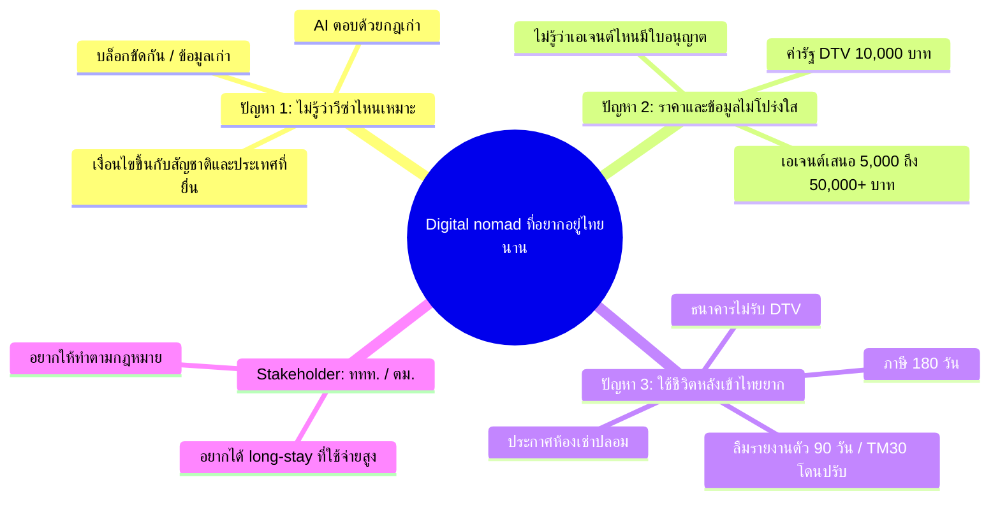

# {BRAND}: เอกสารส่งความคืบหน้า (Progress Submission)

> All for One University · สาย Software "Make Me Money" · ส่ง 25 ต.ค. 2026 เวลา 12:00–13:30 · นำเสนอ 25 ต.ค. 19:00
> `{BRAND}` = ชื่อใน `SITE.name` (`app/src/config/site.ts`) ตอนนี้คือ **"Yoo Yaao"** ให้ find-replace เมื่อได้ชื่อจริง
> ตัวเลขธุรกิจทั้งหมดมาจาก `docs/business-model.md` · ✅ = มีแหล่งอ้างอิง · 🧮 = model หรือค่าประมาณ ไม่ใช่การพยากรณ์

---

## 1) ไอเดีย (1 ย่อหน้า) + ข้อจำกัด 3 ข้อ

**{BRAND}** คือแอป (PWA ติดตั้งบนมือถือได้) ภาษาอังกฤษ สำหรับ digital nomad และชาวต่างชาติที่อยากอยู่ไทยระยะยาว ผู้ใช้ตอบคำถาม 5 ข้อ (สัญชาติ, ประเทศที่อาศัย, รายได้, เงินเก็บ, ระยะเวลาที่อยากอยู่) แล้ว **Visa Finder** จะจัดอันดับวีซ่าที่เหมาะ (DTV, LTR, Privilege, Visa-exempt, Retirement) พร้อมเหตุผลและ checklist เอกสาร โดยทุกข้อมูลมีลิงก์แหล่งทางการและวันที่ตรวจล่าสุด เมื่อมาถึงไทยแล้ว **Stay Tools** จะคำนวณวันรายงานตัว 90 วัน, วันวีซ่าหมด และเกณฑ์ภาษี 180 วัน ส่วน **Local Buddies** ให้จองคนท้องถิ่นช่วยเรื่องที่ยากในชีวิตจริง เช่นไปดูห้องหรือพาไปเปิดบัญชี แอปทำเงิน 3 ทาง ได้แก่ **B2C** (Pro $8/เดือน + affiliate ประกัน/eSIM), **B2B** (listing ของ coworking และส่ง lead ให้เอเจนต์ที่มีใบอนุญาต) และ **C2C** (หัก 20% จากการจอง buddy) เป้าหมายคือให้ชาวต่างชาติ **อยู่ไทยนานขึ้นอย่างถูกกฎหมายและใช้จ่ายในไทยมากขึ้น**

**ข้อจำกัด 3 ข้อ**

1. **เวลา:** มีไม่ถึง 3 วันก่อนส่ง จึงทำ MVP เฉพาะประเทศไทย (วีซ่า 5 แบบ + 3 เมือง: Bangkok, Chiang Mai, Phuket) ส่วนประเทศ SEA อื่นและการแจ้งเตือนผ่าน LINE ไว้เฟสหลัง
2. **งบ:** ต้นทุนโครงสร้างพื้นฐาน ~$21–66/เดือน (Vercel Pro $20 เพราะแผนฟรีห้ามใช้เชิงพาณิชย์, Supabase free แล้วค่อยขึ้น $25, โดเมน ~$12/ปี) ไม่ใช้ API ราคาแพง (เช่น Google Places หรือ Numbeo เชิงพาณิชย์ที่เริ่ม $260/เดือน) จึงเก็บข้อมูลเมืองเอง ช่วงเดโมใช้ Stripe test mode
3. **ข้อมูลและกฎหมาย:** กฎวีซ่าไทยเปลี่ยนบ่อย (ล่าสุดวีซ่าฟรีลดจาก 60 เหลือ 30 วันตั้งแต่ 15 ก.ย. 2026 ✅) จึงต้องตรวจแหล่งทางการเป็นรอบ แอปให้ "ข้อมูล" เท่านั้น **ไม่ยื่นวีซ่าแทน** เพราะเป็นงานที่มีกฎหมายควบคุม ใช้วิธีส่งต่อ (referral) ไปเอเจนต์และทนายที่มีใบอนุญาต และ buddy ห้ามให้คำแนะนำด้านวีซ่าหรือกฎหมาย

---

## 2) ใครใช้ และเจอปัญหาอะไร (mind map)

**ผู้ใช้หลัก:** digital nomad / remote worker ที่อ่านภาษาอังกฤษและอยากอยู่ไทยหลายเดือน (ชาวตะวันตก, ชาวอินเดียซึ่งเป็นตลาดที่โตเร็วสุดในปี 2025 ที่ ~2.48 ล้านคน +16–18% ✅, ผู้ถือหรือผู้สนใจ DTV)

**3 ปัญหาของผู้ใช้**
1. **ไม่รู้ว่าวีซ่าตัวไหนเหมาะ:** เงื่อนไขขึ้นกับทั้งสัญชาติและประเทศที่ยื่น บล็อกแต่ละที่ให้ข้อมูลขัดกัน บางบล็อกยังเขียนว่า "ไทยไม่มีวีซ่า nomad" ทั้งที่มี DTV แล้ว ✅
2. **ราคาและข้อมูลไม่โปร่งใส:** ค่าธรรมเนียมรัฐของ DTV คือ ฿10,000 แต่เอเจนต์เสนอราคา ฿5,000 ถึงกว่า ฿50,000 จนมีกระทู้ถามว่า "ทำไมแพงกว่าค่าวีซ่าตั้ง 5 เท่า" ✅
3. **ใช้ชีวิตหลังเข้าไทยยาก:** ลืมรายงานตัว 90 วันหรือ TM30 (ยื่นช้าปรับ ฿1,600–10,000 ✅), ไม่รู้เรื่องภาษี 180 วัน, ธนาคารส่วนใหญ่ไม่เปิดบัญชีให้ผู้ถือ DTV ตั้งแต่ราว มี.ค. 2025 ✅ และเจอประกาศห้องเช่าปลอม

**ผู้มีส่วนได้ส่วนเสีย (stakeholder) 1 ราย: ททท. / ตม.** ต้องการนักท่องเที่ยวระยะยาวที่ **ใช้จ่ายสูงและทำตามกฎหมาย** ปี 2025 นักท่องเที่ยวต่างชาติลดลง 7.23% ✅ ททท. จึงหันไปเน้นกลุ่มใช้จ่ายสูง และรัฐลดวีซ่าฟรีเหลือ 30 วันเพราะมีการใช้ผิดวัตถุประสงค์



แบบข้อความ (สำรอง กรณีระบบไม่แสดง Mermaid):

```
                     [ Digital nomad ที่อยากอยู่ไทยนาน ]
                    /                |                  \
   ไม่รู้ว่าวีซ่าไหนเหมาะ     ราคาและข้อมูลไม่โปร่งใส      ใช้ชีวิตหลังเข้าไทยยาก
   (สัญชาติ + ประเทศที่ยื่น)   (ค่ารัฐ ฿10k vs เอเจนต์ ฿50k+)  (90 วัน/TM30, ภาษี 180 วัน,
                                                       ธนาคาร, ห้องเช่าปลอม)
                                     |
                [ Stakeholder: ททท./ตม. อยากได้ long-stay ที่ใช้จ่ายสูงและถูกกฎหมาย ]
```

---

## 3) เทียบคู่แข่ง 2 ราย

| ชื่อ | ลิงก์ | ข้อดี | ข้อเสีย | {BRAND} ต่างอย่างไร |
| --- | --- | --- | --- | --- |
| **Nomad List** | https://nomads.com | ข้อมูลเมืองทั่วโลกกว่า 1,500 เมือง, community ใหญ่, มีตัวนับ 183 วัน | ข้อมูลวีซ่าเป็นโน้ตที่ผู้ใช้เขียนเอง ไม่มีวันที่หรือแหล่งทางการ FAQ ของเว็บเองยอมรับว่าบางข้อมูลไม่แม่น และไม่เจาะไทย ✅ | เจาะไทย โดยทุกกฎมีแหล่งทางการและวันที่ · Finder จัดอันดับวีซ่าตามพาสปอร์ตของผู้ใช้ · ระบบเตือนหลังเข้าประเทศ · มี buddy คนท้องถิ่น |
| **SafetyWing "Nomad Border Pass" (Plumia)** | https://safetywing.com/nomad-border-pass | มีคนช่วยยื่นวีซ่า 10+ ประเทศรวมไทย บริษัทแม่มีทุน $35M ✅ | ราคา **$400–600/เดือน** และต้องมีรายได้ $4,000/เดือนขึ้นไป ✅ แพงเกินกว่าที่ nomad ส่วนใหญ่จะจ่าย | ฟรีเป็นหลัก หรือ Pro **$8/เดือน** · เป็นกลางและแนะนำเอเจนต์ที่มีใบอนุญาตได้ · เราเป็นพันธมิตร affiliate ประกันของ SafetyWing ได้ด้วย ไม่ต้องชนกันตรงๆ |

(คู่แข่งอื่นที่ดูไว้: **iVisa** ยื่น e-visa ระยะสั้นแต่ไม่ครอบคลุม DTV/LTR และค่าบริการไม่โปร่งใส · **เอเจนต์วีซ่าไทย** คิด ฿3,000–55,000 ต่อเคส ซึ่งเป็นลูกค้า B2B ของเรามากกว่าคู่แข่ง)

---

## 4) Storyboard 3 ช่อง

| ช่อง | ฉาก | สิ่งที่เห็นในแอป |
| --- | --- | --- |
| **1. ก่อน** | **ปรียา** โปรแกรมเมอร์ชาวอินเดียอายุ 29 อยากไปทำงานที่เชียงใหม่ 6 เดือน เปิดบล็อก 5 เว็บแล้วเจอข้อมูลขัดกัน เอเจนต์เสนอราคา ฿45,000 เลยไม่รู้จะเชื่อใคร | (ภาพแท็บเบราว์เซอร์เต็มจอ, หน้าคิ้วขมวด) |
| **2. ใช้แอป** | เธอเปิด `/finder` ตอบ 5 ข้อใน 2 นาที แอปตอบว่า **"DTV: best match"** พร้อมเหตุผล, checklist ของสถานทูตไทยในอินเดีย, ค่ารัฐ ฿10,000 และลิงก์ thaievisa.go.th ที่ระบุ "verified on" แล้วเธอซื้อประกันผ่านลิงก์ในหน้า | Finder → ผลลัพธ์ → `/visas/dtv` |
| **3. หลัง** | อยู่เชียงใหม่แล้ว เธอสมัคร **Pro $8** แอปเตือนรายงานตัว 90 วันล่วงหน้า 15 วัน เธอจอง **Local Buddy** ให้ช่วยไปดูคอนโด (ไม่โดนหลอกมัดจำ) และเจอ coworking จาก listing ของ partner สุดท้ายอยู่ครบ 6 เดือน ใช้จ่ายในไทย ~฿200,000 🧮 โดยไม่ผิดกฎหมาย | `/tools/90-day` → `/buddies/[id]` → `/cities/chiang-mai` |

---

## 5) หัวข้อนำเสนอ (Guideline)

### Target Audience
- **หลัก:** digital nomad / remote worker และชาวต่างชาติ long-stay ที่อ่านภาษาอังกฤษ ทั้งชาวตะวันตก ชาวอินเดีย และผู้ถือ DTV (วีซ่า 5 ปี อยู่ได้ครั้งละ 180 วัน ✅)
- **รอง:** ผู้เกษียณที่ดู LTR หรือ Retirement visa (LTR อนุมัติแล้ว 12,011 รายใน 4 ปี ✅)
- **ฝั่งจ่ายเงิน B2B:** coworking, coliving, เอเจนต์และทนายที่มีใบอนุญาต · **ฝั่ง supply C2C:** คนไทยและ expat ที่อยากเป็น Local Buddy

### Problem
กฎวีซ่าไทยซับซ้อน ขึ้นกับสัญชาติและประเทศที่ยื่น และเปลี่ยนบ่อย (2 ครั้งใหญ่ในปี 2026 ✅) ข้อมูลในเน็ตกระจัดกระจายและเก่า ราคาเอเจนต์ไม่โปร่งใส (฿10k vs ฿50k+) และหลังเข้าไทยยังมีหน้าที่ที่ลืมง่ายซึ่งมีค่าปรับ คนจำนวนมากจึง **ออกจากไทยเร็วกว่าที่ตั้งใจ หรือทำผิดกฎโดยไม่รู้ตัว**

### Solution
PWA ภาษาอังกฤษ 1 แอปที่ครอบคลุมตั้งแต่ก่อนมาจนอยู่จริง:
1. **Visa Finder:** จัดอันดับ 5 วีซ่าตามโปรไฟล์ พร้อมเหตุผล
2. **Visa guides:** ทุกข้อมูลมีแหล่งทางการและ "verified on"
3. **Stay Tools:** 90 วัน, วันวีซ่าหมด, นับ 180 วันภาษี, checklist, export .ics
4. **City guides:** Bangkok, Chiang Mai, Phuket
5. **Local Buddies (C2C)**, **Partners และ Expert help (B2B)**, **Pro (B2C)** ผ่าน Stripe

### Unique Value
1. **ข้อมูลสดและตรวจสอบได้:** ทุกกฎมีลิงก์ทางการและวันที่ ขณะที่ AI และบล็อกมักตอบด้วยกฎเก่า
2. **ราคาที่ช่องว่างของตลาด:** ฟรีหรือ $8/เดือน ระหว่างบล็อกฟรีที่ข้อมูลเก่ากับ concierge $400–600/เดือน
3. **เป็นกลาง:** เราไม่ยื่นวีซ่าเอง จึงแนะนำเอเจนต์ที่มีใบอนุญาตได้อย่างน่าเชื่อถือ และได้ค่า lead แทนที่จะไปแข่งกับเขา
4. **รายได้ 3 ขา B2C + B2B + C2C:** ไม่พึ่ง traffic หรือ affiliate อย่างเดียว (affiliate คิดเป็นแค่ ~21% ของรายได้ base)

### Expected Outcome
- **ผลงาน:** เว็บใช้งานได้จริง มี Finder, คู่มือ 5 วีซ่า, เครื่องมือ 4 ตัว, 3 เมือง และ checkout จริงทั้ง 3 ขา (Stripe test mode)
- **ธุรกิจ (🧮 base model ไม่ใช่การพยากรณ์):** เดือนที่ 12 มีรายได้ **~$1,890/เดือน (≈ ฿62,500)** หรือ run-rate ~$22,700/ปี · รายได้รายเดือนเกินต้นทุนตั้งแต่ **เดือนที่ 7** · คืนทุนสะสมเดือนที่ 10 · กรณีแย่ (conservative) ได้ ~$550/เดือนที่เดือน 12 ส่วนกรณีดี (optimistic) ได้ ~$5,470
- **ท่องเที่ยว:** นักท่องเที่ยวต่างชาติ 1 คนใช้จ่ายเฉลี่ย ~฿47,000/ทริป ✅🧮 ส่วน nomad ใช้ ~฿33,000–45,000 **ต่อเดือน** 🧮 ทุกเดือนที่ช่วยให้เขาอยู่ต่ออย่างถูกกฎหมายจึงเท่ากับได้นักท่องเที่ยวใหม่เกือบ 1 คน
- **KPI 90 วันแรก:** สัมภาษณ์ nomad 10 คน, finder completions 100+, Pro 10+, partners 5, buddies 10

---

## 6) แผนรายวันถึง 25 ต.ค. 2026

| วัน / เวลา | งาน | ผู้รับผิดชอบ | ผลลัพธ์ที่ต้องได้ |
| --- | --- | --- | --- |
| **23 ต.ค. (ค่ำ)** | Wave 1: UX flow (Miro), design system, data วีซ่า 5 แบบ + 3 เมือง, DB/RLS + API, โมเดล 3D, **business model + pitch docs** | main + 6 agents | สัญญาข้อมูลนิ่ง, `docs/business-model.md`, ร่างสคริปต์ |
| **23 ต.ค. (ดึก) → 24 ต.ค. (เช้า)** | Wave 2: frontend core (home, finder, visas, tools, cities) + money pages (buddies, partners, experts, pricing, account, legal) | Frontend A / B | deploy ครั้งแรกบน Vercel |
| **24 ต.ค. 09:00–13:00** | QA ทั้ง flow ที่ใช้เงิน (finder → Pro checkout → buddy booking → Stripe dashboard), แก้บั๊ก, Lighthouse/SEO | QA + main | checkout ผ่านครบ 3 ขาใน test mode |
| **24 ต.ค. 13:00–17:00** | ใส่ 3D/animation, ขัดเกลา UI, ตรวจข้อความ legal/disclaimer | 3D/Motion + UI | หน้าแรกพร้อมถ่ายวิดีโอ |
| **24 ต.ค. 17:00–20:00** | อัดเสียงพากย์ภาษาไทย, อัดหน้าจอตาม shot list, ตัดต่อวิดีโอ 2 นาที | Video + ผู้นำเสนอ | `.mp4` ร่างแรก |
| **24 ต.ค. 21:00** | **Internal deadline:** เว็บ live + วิดีโอ + เอกสาร | main | ทุกอย่างพร้อมส่ง |
| **24 ต.ค. 21:00–23:00** | ทำสไลด์ 8–10 หน้า, ซ้อมพูดและ Q&A รอบแรก | ผู้นำเสนอ | deck + บันทึกการซ้อม |
| **25 ต.ค. 08:00–11:30** | smoke test เว็บอีกรอบ, อัปโหลดวิดีโอขึ้น Google Drive (ตั้ง "anyone with link"), ตรวจลิงก์ | main | ลิงก์เว็บ + ลิงก์วิดีโอเปิดได้ |
| **25 ต.ค. 12:00–13:30** | **ส่งงานทางการ** (แก้ไม่ได้หลังส่ง) | ผู้ส่ง | ใบยืนยันการส่ง |
| **25 ต.ค. 14:00–18:00** | ซ้อมพูด 2 รอบ + Q&A 8 ข้อ, เตรียมเดโมสำรอง (วิดีโอ/screenshot เผื่อเน็ตล่ม) | ผู้นำเสนอ | จับเวลาได้ตามกำหนด |
| **25 ต.ค. 19:00** | **นำเสนอ** | ทีม | |
