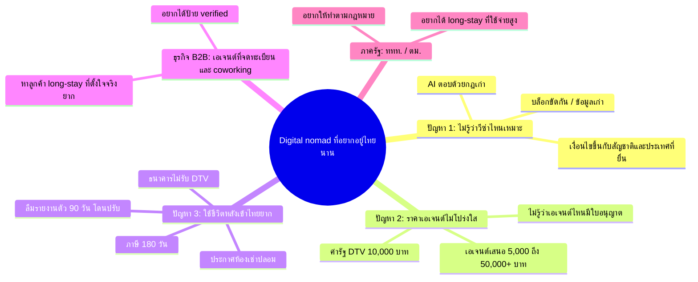

# Yoo Yaao: เอกสารส่งความคืบหน้า (Progress Submission)

> All for One University · สาย Software "Make Me Money" · ส่ง 25 ต.ค. 2026 เวลา 12:00–13:30 · นำเสนอ 25 ต.ค. 19:00
> เว็บจริง: https://yoo-yaao.vercel.app · โค้ด (public): https://github.com/PERPERn/yoo-yaao · Miro: https://miro.com/app/board/uXjVEWEwo1M=/
> ตัวเลขธุรกิจทั้งหมดมาจาก `docs/business-model.md` · ✅ = มีแหล่งอ้างอิง · 🧮 = model หรือค่าประมาณ ไม่ใช่การพยากรณ์
> ข้อมูลตัวอย่าง: หน้า `/partner`, `/admin` และ `/messages` แสดงข้อมูลตัวอย่างที่มีป้าย "Demo view — sample data" เมื่อไม่ได้ล็อกอิน ส่วนกราฟรายได้ใน admin ติดป้าย "Sample" ทุกจุด ยังไม่ใช่ยอดขายจริง

## สารบัญงานส่ง

| ข้อ | งาน | อยู่ที่ไหน |
| --- | --- | --- |
| 1 | ไอเดีย 1 ย่อหน้า + ข้อจำกัด 3 ข้อ | §1 ในไฟล์นี้ |
| 2 | Mind map ใครใช้และเจอปัญหาอะไร | §2 · `docs/pitch/mindmap-th.html` · Miro frame "4. Mind map" |
| 3 | ตารางเทียบคู่แข่ง 2 ราย | §3 · `docs/pitch/competitors-th.html` |
| 4 | Storyboard 3 ช่อง | §4 · `docs/pitch/storyboard-th.html` |
| 5 | Wireframe | Miro frame "3. Mobile wireframes" (ฝั่งผู้ใช้) และ "5. Business, partner and admin wireframes" (ฝั่งธุรกิจ) |
| 6 | หัวข้อนำเสนอ | §5 ในไฟล์นี้ และ `docs/pitch/deck-outline-th.md` |
| 7 | แผนรายวัน | §6 ในไฟล์นี้ |

---

## 1) ไอเดีย (1 ย่อหน้า) + ข้อจำกัด 3 ข้อ

**Yoo Yaao** คือเว็บแอป (PWA ติดตั้งบนมือถือได้) ภาษาอังกฤษ สำหรับ digital nomad และชาวต่างชาติที่อยากอยู่ไทยระยะยาว ผู้ใช้ตอบคำถาม 6 ข้อ แล้ว **Visa Finder** จะจัดอันดับวีซ่าที่เหมาะ (DTV, LTR, Privilege, Visa-exempt, Retirement) พร้อมเหตุผลและ checklist เอกสาร ทุกข้อมูลมีลิงก์แหล่งทางการและวันที่ตรวจล่าสุด เมื่อมาถึงไทยแล้ว **Stay Tools** คำนวณวันรายงานตัว 90 วัน วันวีซ่าหมด และเกณฑ์ภาษี 180 วัน ถ้าต้องการคนช่วยยื่น ผู้ใช้ส่งคำขอไปยัง **เอเจนต์ที่เราตรวจตัวตนและใบอนุญาต TAT แล้ว** และคุยกันต่อในแชทของเว็บ ส่วน **Local Buddies** ให้จองคนท้องถิ่นช่วยเรื่องชีวิตจริง เช่นไปดูห้องหรือพาไปเปิดบัญชี ฝั่งธุรกิจมีพื้นที่แยกที่ `/business` สำหรับสมัคร มีพอร์ทัล `/partner` สำหรับดู lead และจัดการ listing และมี dashboard `/admin` สำหรับทีมเราตรวจใบสมัครและดูรายได้ แอปทำเงิน 3 ทาง คือ **B2C** (Pro $8/เดือน และ affiliate ประกัน/eSIM), **B2B** (featured listing $49/เดือนและค่า lead จากเอเจนต์) และ **C2C** (หัก 20% จากการจอง buddy) เป้าหมายคือให้ชาวต่างชาติ **อยู่ไทยนานขึ้นอย่างถูกกฎหมายและใช้จ่ายในไทยมากขึ้น**

**ข้อจำกัด 3 ข้อ**

1. **เวลา:** มีไม่ถึง 3 วันก่อนส่ง จึงทำ MVP เฉพาะประเทศไทย (วีซ่า 5 แบบ + 3 เมือง: Bangkok, Chiang Mai, Phuket) ส่วนประเทศ SEA อื่น การแจ้งเตือนผ่าน LINE และการจ่ายเงินให้ buddy จริง (Stripe Connect) ไว้เฟสหลัง
2. **งบ:** ต้นทุนโครงสร้างพื้นฐาน ~$21–66/เดือน (Vercel Pro $20 เพราะแผนฟรีห้ามใช้เชิงพาณิชย์, Supabase free แล้วค่อยขึ้น $25, โดเมน ~$12/ปี) ไม่ใช้ API ราคาแพง (เช่น Google Places หรือ Numbeo เชิงพาณิชย์ที่เริ่ม $260/เดือน) จึงเก็บข้อมูลเมืองเอง ช่วงเดโมใช้ Stripe test mode หรือโหมดเดโมที่ไม่ตัดเงิน
3. **ข้อมูลและกฎหมาย:** กฎวีซ่าไทยเปลี่ยนบ่อย (ล่าสุดวีซ่าฟรีลดจาก 60 เหลือ 30 วันตั้งแต่ 15 ก.ย. 2026 ✅) จึงต้องตรวจแหล่งทางการเป็นรอบ แอปให้ "ข้อมูล" เท่านั้น **ไม่ยื่นวีซ่าแทน** เพราะเป็นงานที่มีกฎหมายควบคุม เราส่งต่อ (referral) ให้เอเจนต์ที่มีใบอนุญาต และฐานข้อมูลบังคับว่าต้องตรวจตัวตนและใบอนุญาตก่อนอนุมัติ partner ส่วน buddy ห้ามให้คำแนะนำด้านวีซ่าหรือกฎหมาย

---

## 2) ใครใช้ และเจอปัญหาอะไร (mind map)

ภาพ: `docs/pitch/mindmap-th.html` และบน Miro (frame "4. Mind map: users and problems")

**ผู้ใช้หลัก:** digital nomad / remote worker ที่อ่านภาษาอังกฤษและอยากอยู่ไทยหลายเดือน (ชาวตะวันตก, ชาวอินเดียซึ่งเป็นตลาดที่โตเร็วสุดในปี 2025 ที่ ~2.48 ล้านคน +16–18% ✅, ผู้ถือหรือผู้สนใจ DTV)

**3 ปัญหาของผู้ใช้**
1. **ไม่รู้ว่าวีซ่าตัวไหนเหมาะ:** เงื่อนไขขึ้นกับทั้งสัญชาติและประเทศที่ยื่น บล็อกแต่ละที่ให้ข้อมูลขัดกัน บางบล็อกยังเขียนว่า "ไทยไม่มีวีซ่า nomad" ทั้งที่มี DTV แล้ว ✅
2. **ราคาและความน่าเชื่อถือของเอเจนต์ไม่โปร่งใส:** ค่าธรรมเนียมรัฐของ DTV คือ ฿10,000 แต่เอเจนต์เสนอราคา ฿5,000 ถึงกว่า ฿50,000 จนมีกระทู้ถามว่า "ทำไมแพงกว่าค่าวีซ่าตั้ง 5 เท่า" ✅ และผู้ใช้แยกไม่ออกว่าเอเจนต์ไหนมีใบอนุญาต
3. **ใช้ชีวิตหลังเข้าไทยยาก:** ลืมรายงานตัว 90 วัน (ยื่นช้าปรับ ฿2,000 ตาม immigration.go.th ✅), ไม่รู้เรื่องภาษี 180 วัน, ธนาคารส่วนใหญ่ไม่เปิดบัญชีให้ผู้ถือ DTV ตั้งแต่ราว มี.ค. 2025 ✅ และเจอประกาศห้องเช่าปลอม

**ผู้มีส่วนได้ส่วนเสีย 2 ฝ่าย**
- **ธุรกิจ (B2B):** เอเจนต์ที่จดทะเบียนธุรกิจ (DBD) สำนักงานกฎหมาย, coworking และ coliving อยากได้ลูกค้า long-stay ที่ตั้งใจย้ายมาจริง และต้องแข่งกับเอเจนต์ที่ไม่มีใบอนุญาต ป้าย "verified" ช่วยให้ลูกค้าเชื่อถือ (ฝั่ง supply ของ C2C คือคนไทยและ expat ที่อยากเป็น Local Buddy)
- **ททท. / ตม.:** ต้องการนักท่องเที่ยวระยะยาวที่ **ใช้จ่ายสูงและทำตามกฎหมาย** ปี 2025 นักท่องเที่ยวต่างชาติลดลง 7.23% ✅ ททท. จึงหันไปเน้นกลุ่มใช้จ่ายสูง และรัฐลดวีซ่าฟรีเหลือ 30 วันเพราะมีการใช้ผิดวัตถุประสงค์

---

## 3) เทียบคู่แข่ง 2 ราย

ภาพ: `docs/pitch/competitors-th.html`

| ชื่อ | ลิงก์ | ข้อดี | ข้อเสีย | Yoo Yaao ต่างอย่างไร |
| --- | --- | --- | --- | --- |
| **Nomad List** | https://nomads.com | ข้อมูลเมืองทั่วโลกกว่า 1,500 เมือง, community ใหญ่, มีตัวนับ 183 วัน | ข้อมูลวีซ่าเป็นโน้ตที่ผู้ใช้เขียนเอง ไม่มีวันที่หรือแหล่งทางการ FAQ ของเว็บเองยอมรับว่าบางข้อมูลไม่แม่น และไม่เจาะไทย ✅ | เจาะไทย ทุกกฎมีแหล่งทางการและวันที่ · Finder จัดอันดับวีซ่าตามพาสปอร์ตของผู้ใช้ · เครื่องมือหลังเข้าประเทศ · มี buddy คนท้องถิ่น |
| **Plumia "Nomad Citizen" (SafetyWing ขายแทน)** | https://intercom.help/safetywing/en/articles/11088830-nomad-citizen-faq | ประกัน + คุ้มครองรายได้ + Nomad Border Pass ช่วยยื่นวีซ่า 10+ ประเทศรวมไทย บริษัทแม่มีทุน $35M ✅ | ราคา **$400/เดือน (อายุ 18–39) หรือ $600 (40–49)** และต้องมีรายได้ $4,000/เดือนขึ้นไป ✅ แพงเกินกว่าที่ nomad ส่วนใหญ่จะจ่าย | ฟรีเป็นหลัก หรือ Pro **$8/เดือน** · เป็นกลาง ส่งเคสให้เอเจนต์ที่ตรวจตัวตนและใบอนุญาตแล้ว แล้วคุยกันในแชทของเว็บ · เป็นพันธมิตร affiliate ประกันของ SafetyWing ได้ ไม่ต้องชนกันตรงๆ |

(คู่แข่งอื่นที่ดูไว้: **iVisa** ยื่น e-visa ระยะสั้นแต่ไม่ครอบคลุม DTV/LTR และค่าบริการไม่โปร่งใส · **เอเจนต์วีซ่าไทย** คิด ฿3,000–10,000+ ต่อเคส ซึ่งเป็นลูกค้า B2B ของเรามากกว่าคู่แข่ง)

---

## 4) Storyboard 3 ช่อง

ภาพ: `docs/pitch/storyboard-th.html` (ปรียาเป็นตัวละครสมมติ)

| ช่อง | ฉาก | สิ่งที่เห็นในแอป |
| --- | --- | --- |
| **1. ก่อน** | **ปรียา** โปรแกรมเมอร์ชาวอินเดียอายุ 29 อยากไปทำงานที่เชียงใหม่ 6 เดือน เปิดบล็อก 5 เว็บแล้วเจอข้อมูลขัดกัน เอเจนต์ที่ไม่รู้ว่ามีใบอนุญาตหรือเปล่าเสนอราคา ฿45,000 เลยไม่รู้จะเชื่อใคร | (ภาพแท็บเบราว์เซอร์เต็มจอ) |
| **2. ใช้แอป** | เธอเปิด `/finder` ตอบ 6 ข้อในราว 2 นาที แอปตอบว่า **"DTV: best match"** พร้อมเหตุผล, checklist เอกสาร, ค่ารัฐ ฿10,000 และลิงก์ thaievisa.go.th ที่ระบุ "verified on" แล้วเธอซื้อประกันผ่านลิงก์ในหน้า และส่งคำขอ "Get expert help" | `/finder` → `/visas/dtv` → `/experts` |
| **3. หลัง** | เอเจนต์ที่ผ่านการตรวจทะเบียนธุรกิจ (DBD) ตอบเธอในแชท เธอสมัคร **Pro $8** ตั้งเตือนรายงานตัว 90 วันลงปฏิทิน และจอง **Local Buddy** ไปดูคอนโดด้วยกันจึงไม่โดนหลอกมัดจำ สุดท้ายอยู่ครบ 6 เดือน ใช้จ่ายในไทย ~฿200,000 🧮 โดยไม่ผิดกฎหมาย | `/messages` → `/tools/90-day` → `/buddies/[id]` |

ฉากเดียวกันจากฝั่งธุรกิจ: เอเจนต์สมัครที่ `/business/apply` → admin ติ๊ก "Identity checked" และ "Licence checked" แล้วจึงกด Approve ได้ → เอเจนต์ได้ role partner และเห็น lead ของปรียาใน `/partner` → จ่าย featured listing $49 หลังได้รับอนุมัติ

---

## 5) หัวข้อนำเสนอ (Guideline)

### Target Audience
- **หลัก:** digital nomad / remote worker และชาวต่างชาติ long-stay ที่อ่านภาษาอังกฤษ ทั้งชาวตะวันตก ชาวอินเดีย และผู้ถือ DTV (วีซ่า 5 ปี อยู่ได้ครั้งละ 180 วัน ✅)
- **รอง:** ผู้เกษียณที่ดู LTR หรือ Retirement visa (LTR อนุมัติแล้ว 12,010 รายใน 4 ปี ✅)
- **ฝั่งจ่ายเงิน B2B:** เอเจนต์วีซ่าและทนายที่มีใบอนุญาต, coworking, coliving · **ฝั่ง supply C2C:** คนไทยและ expat ที่อยากเป็น Local Buddy

### Problem
กฎวีซ่าไทยซับซ้อน ขึ้นกับสัญชาติและประเทศที่ยื่น และเปลี่ยนบ่อย (2 ครั้งใหญ่ในปี 2026 ✅) ข้อมูลในเน็ตกระจัดกระจายและเก่า ราคาเอเจนต์ไม่โปร่งใส (฿10k vs ฿50k+) และผู้ใช้ไม่รู้ว่าเอเจนต์ไหนมีใบอนุญาต หลังเข้าไทยยังมีหน้าที่ที่ลืมง่ายและมีค่าปรับ คนจำนวนมากจึง **ออกจากไทยเร็วกว่าที่ตั้งใจ หรือทำผิดกฎโดยไม่รู้ตัว**

### Solution
เว็บแอป 1 ตัว แบ่งเป็น 3 ฝั่งที่ใช้ฐานข้อมูลเดียวกัน:

1. **ฝั่งผู้ใช้ (`/`):** Visa Finder จัดอันดับ 5 วีซ่า · คู่มือวีซ่าที่ทุกข้อมูลมีแหล่งทางการและ "verified on" · Stay Tools (90 วัน, วันวีซ่าหมด, นับ 180 วันภาษี, checklist, export .ics) · คู่มือ 3 เมือง · Local Buddies · Pro · แชทกับเอเจนต์ที่ `/messages`
2. **ฝั่งธุรกิจ (`/business`, `/partner`):** พื้นที่แยกสำหรับธุรกิจ สมัครพร้อมเลขทะเบียนธุรกิจ (DBD) หรือเลขใบอนุญาตสภาทนายความ หลังสมัครระบบส่งลิงก์ login ทางอีเมลให้ติดตามสถานะ พอร์ทัลให้ดู lead และกด ตอบแล้ว/ได้งาน/ไม่ได้งาน แก้ listing ตอบแชทลูกค้า และซื้อ featured listing **หลังได้รับอนุมัติ**
3. **ฝั่ง admin (`/admin`):** ตรวจใบสมัครด้วย checklist ตัวตนและใบอนุญาต (ปุ่ม Approve กดไม่ได้จนกว่าจะติ๊กครบ) มอบหมาย lead ให้เอเจนต์ เปิด/ปิด featured จัดการ role ผู้ใช้ และดูรายได้ (ข้อมูลรายได้ดูได้เฉพาะ admin)

การจ่ายเงินทุกขาผ่าน Stripe Checkout และจบที่หน้าสถานะ `/checkout/status` ซึ่งบอกผลชัดเจน 1 ใน 4 แบบ: จ่ายแล้ว, ยกเลิก, ล้มเหลว/หมดเวลา (กดลองใหม่ได้) หรือใบเสร็จเดโมที่ไม่ตัดเงินเมื่อยังไม่เปิด Stripe (แผนภาพ: `docs/pitch/payment-flow.html`)

### Unique Value
1. **ข้อมูลสดและตรวจสอบได้:** ทุกกฎมีลิงก์ทางการและวันที่ ขณะที่ AI และบล็อกมักตอบด้วยกฎเก่า
2. **Partner ที่ตรวจแล้วจริง ไม่ใช่แค่ป้าย:** ฐานข้อมูลปฏิเสธการอนุมัติใบสมัครที่ยังไม่ได้ตรวจตัวตน (และใบอนุญาตสำหรับเอเจนต์) แม้แต่ admin ก็ข้ามไม่ได้ ผู้ใช้จึงคุยกับเอเจนต์ที่มีใบอนุญาตเท่านั้น
3. **ราคาที่ช่องว่างของตลาด:** ฟรีหรือ $8/เดือน ระหว่างบล็อกฟรีที่ข้อมูลเก่ากับ concierge $400–600/เดือน
4. **เป็นกลาง:** เราไม่ยื่นวีซ่าเอง จึงแนะนำเอเจนต์ได้อย่างน่าเชื่อถือ และได้ค่า lead แทนที่จะแข่งกับเขา
5. **รายได้ 3 ขา B2C + B2B + C2C:** ไม่พึ่ง traffic หรือ affiliate อย่างเดียว (affiliate คิดเป็นแค่ ~21% ของรายได้ base case 🧮)

### Business model: รายได้ 3 ขา

| ขา | ใครจ่าย | ราคา | เหตุผลที่ยอมจ่าย |
| --- | --- | --- | --- |
| **B2C** | nomad | Pro **$8/เดือน** หรือ **$59/ปี** · affiliate ประกัน SafetyWing ~10% recurring, Genki 5–10% · eSIM Airalo 10% | เลี่ยงค่าปรับรายงานตัว 90 วันช้าครั้งเดียว (฿2,000 ≈ $60 ผู้ใช้จ่ายเอง) คุ้มค่า Pro ราว 7 เดือน · ประกันสุขภาพจำเป็นสำหรับ LTR และวีซ่าเกษียณ ส่วน DTV บางสถานทูตอาจขอ |
| **B2B** | เอเจนต์, coworking, coliving | featured listing **$49/เดือน** (ราคา Founding Partner 20 รายแรก จ่ายหลังได้รับอนุมัติ) · lead ที่ผ่านเกณฑ์ **~$45/lead** หรือแพ็กเกจ Verified Agent **$199/เดือน** | เอเจนต์คิดค่าบริการ ฿3,000–10,000+ ต่อเคส ลูกค้า 1 รายคุ้มค่า lead หลายเท่า |
| **C2C** | nomad จ่าย buddy ผ่านเรา | session 60 นาที **$25–60** แพลตฟอร์มเก็บ **20%** | ช่วยเรื่องที่ลำบากจริง เช่นดูห้อง เปิดบัญชี ไม่ใช่คำแนะนำกฎหมาย |

ต้นทุน infra $21–66/เดือน ส่วนต้นทุนจริงคือเวลาตรวจข้อมูลวีซ่าและการตลาด

### Expected Outcome
- **ผลงาน (ทำเสร็จแล้ว, live ที่ https://yoo-yaao.vercel.app):** Finder, คู่มือ 5 วีซ่า, Stay Tools, 3 เมือง, Local Buddies, Pro, ฝั่งธุรกิจ `/business` พร้อมการตรวจสอบ partner, พอร์ทัล `/partner`, dashboard `/admin`, แชทลูกค้ากับเอเจนต์ และหน้าสถานะการจ่ายเงิน โค้ดเปิดเป็น public บน GitHub
- **สิ่งที่ยังเป็นเดโม:** การจ่ายเงินใช้ Stripe test mode หรือโหมดเดโมที่ไม่ตัดเงิน · ตัวเลขใน dashboard admin เป็นข้อมูลตัวอย่างที่ติดป้าย Sample · ยังไม่มีผู้ใช้หรือ partner จริง
- **ธุรกิจ (🧮 base model ไม่ใช่การพยากรณ์):** เดือนที่ 12 มีรายได้ **~$1,890/เดือน (≈ ฿62,500)** หรือ run-rate ~$22,700/ปี · รายได้รายเดือนเกินต้นทุนตั้งแต่ **เดือนที่ 7** · คืนทุนสะสมเดือนที่ 10 · กรณีแย่ (conservative) ~$550/เดือนที่เดือน 12 ส่วนกรณีดี (optimistic) ~$5,470
- **ท่องเที่ยว:** นักท่องเที่ยวต่างชาติ 1 คนใช้จ่ายเฉลี่ย ~฿47,000/ทริป ✅🧮 ส่วน nomad ใช้ ~฿33,000–45,000 **ต่อเดือน** 🧮 ทุกเดือนที่ช่วยให้เขาอยู่ต่ออย่างถูกกฎหมายจึงเท่ากับได้นักท่องเที่ยวใหม่เกือบ 1 คน และเงินค่า buddy ถึงมือคนไทยในพื้นที่โดยตรง
- **KPI 90 วันแรก:** สัมภาษณ์ nomad 10 คน, finder completions 100+, Pro 10+, partners ที่ผ่านการตรวจ 5 ราย, buddies 10

---

## 6) แผนรายวันถึง 25 ต.ค. 2026

| วัน / เวลา | งาน | ผู้รับผิดชอบ | ผลลัพธ์ | สถานะ |
| --- | --- | --- | --- | --- |
| **23 ต.ค. (ค่ำ)** | Wave 1: UX flow + wireframe (Miro), design system, data วีซ่า 5 แบบ + 3 เมือง, DB/RLS + API, โมเดล 3D, business model + pitch docs | main + 6 agents | สัญญาข้อมูลนิ่ง, `docs/business-model.md` | เสร็จ |
| **23 ต.ค. (ดึก) → 24 ต.ค. (เช้า)** | Wave 2: frontend ฝั่งผู้ใช้ (home, finder, visas, tools, cities) + หน้าที่ทำเงิน (buddies, partners, experts, pricing, account, legal) | Frontend A / B | deploy preview ครั้งแรก | เสร็จ |
| **24 ต.ค. (กลางวัน)** | ฝั่งธุรกิจ `/business`, พอร์ทัล `/partner`, dashboard `/admin`, ระบบตรวจสอบ partner ในฐานข้อมูล, แชทลูกค้ากับเอเจนต์, หน้าสถานะการจ่ายเงิน | DB, Business, Admin agents | ครบ 3 ฝั่ง | เสร็จ |
| **24 ต.ค. (บ่าย–เย็น)** | security review และแก้ตามผล, ปรับฟอนต์และ layout, อนิเมชันการจ่ายเงิน, deploy production, เปิด repo เป็น public | Security/QA, UI, main | https://yoo-yaao.vercel.app | เสร็จ |
| **24 ต.ค. (ค่ำ)** | อัปเดตเอกสารส่งงาน (mind map, คู่แข่ง, storyboard, wireframe ฝั่งธุรกิจ), ตัดต่อวิดีโอ 2 นาที | Pitch, Video agents | ไฟล์ใน `docs/pitch/` + `.mp4` ร่างแรก | กำลังทำ |
| **24 ต.ค. 21:00** | **Internal deadline:** เว็บ live + วิดีโอ + เอกสาร | main | ทุกอย่างพร้อมส่ง | |
| **24 ต.ค. 21:00–23:00** | ทำสไลด์ 10 หน้าตาม `deck-outline-th.md`, ซ้อมพูดและ Q&A รอบแรก | ผู้นำเสนอ | deck + บันทึกการซ้อม | |
| **25 ต.ค. 08:00–11:30** | smoke test เว็บ production อีกรอบ, อัปโหลดวิดีโอขึ้น Google Drive (ตั้ง "anyone with link"), ตรวจลิงก์ | main | ลิงก์เว็บ + ลิงก์วิดีโอเปิดได้ | |
| **25 ต.ค. 12:00–13:30** | **ส่งงานทางการ** (แก้ไม่ได้หลังส่ง) | ผู้ส่ง | ใบยืนยันการส่ง | |
| **25 ต.ค. 14:00–18:00** | ซ้อมพูด 2 รอบ + Q&A, เตรียมเดโมสำรอง (วิดีโอ/screenshot เผื่อเน็ตล่ม) | ผู้นำเสนอ | จับเวลาได้ตามกำหนด | |
| **25 ต.ค. 19:00** | **นำเสนอ** (ภาษาไทย) | ทีม | | |
